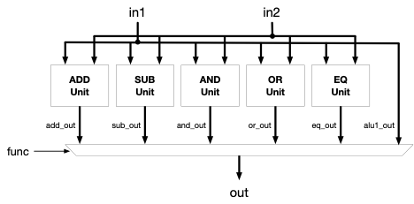
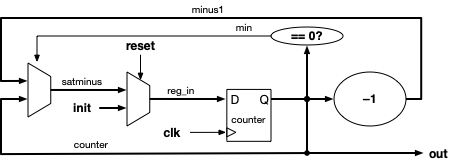
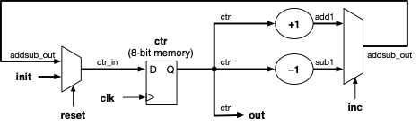
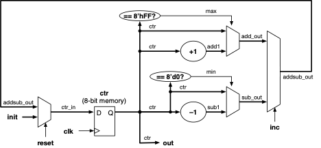

**Designing and Securing Modern Computing Systems**
From Logic Gates to Trusted Kernels

# Project Logic-1 --- Some Basic Circuits

## Purpose: Flex Your Verilog Muscles

In this project you will extend the designs you saw in Project 0 and try
some new (but similar) designs as well.

## Hardware Design Steps

Recall the procedure outlined in class for designing hardware:

**Step 1:** Draw a diagram of your design. Iterate on this design many
times, until you are absolutely sure that it is correct. It won't be.
Worry not.

**Step 2:** Label ***all*** of the wires in your design (as well as
latches).

**Step 3:** Translate the diagram to code --- in particular, specify
each wire and give the logic that generates its state or logical value
at any given moment.

**Step 4:** Run your design in your Verilog simulator. Debug it. Fix it.
Go to Step 1.

You're not done until Step 4 gives no errors. :D

## Build an Arithmetic Logic Unit

In this project we will build a slightly extended ALU; you will not
build it from scratch but will build off of the ALU example in
Project-0.

As mentioned previously, the 16-bit ALU in Project-0 has the following
form:

    //
    // ALU func:
    // 00 = add
    // 01 = sub
    // 10 = AND
    // 11 = OR
    //

    module alu16 (
        input [1:0] func,
        input [15:0] in1,
        input [15:0] in2,
        output [15:0] out
    );

        assign  out = (func == 2'd0) ?  in1 + in2   : 16'dZ;
        assign  out = (func == 2'd1) ?  in1 - in2   : 16'dZ;
        assign  out = (func == 2'd2) ?  in1 & in2   : 16'dZ;
        assign  out = (func == 2'd3) ?  in1 | in2   : 16'dZ;

    endmodule

This project will simply add two more functions, and it will increase
the width of the **function** input from 2 bits to 4 bits.

*Regarding the ALU*

The following is a labeled diagram for what you need to build, with the
various wires labeled:

**Figure: ALU diagram, with labeled wires**

There are six different functions: **add**, **sub**, **bitwise-AND**,
**bitwise-OR**, **PASS1**, and **EQ**. The opcode can be used directly
as the input to the ALU, giving us the following:

**0000** ---\> addition

**0001** ---\> subtraction

**0010** ---\> bitwise-AND

**0011** ---\> bitwise-OR

**0111** ---\> pass SRC1 input to output

**1011** ---\> equality test (16-bit output is either all 1's or all
0's)

Here is the module started for you, where we explicitly make use of
those labels:

    `define ADD       4'b0000
    `define SUB       4'b0001
    `define AND       4'b0010
    `define OR        4'b0011
    `define PASS1     4'b0111
    `define EQ        4'b1011

    module arithmetic_logic_unit (
        input   [3:0]   func,
        input   [15:0]  in1, 
        input   [15:0]  in2, 
        output  [15:0]  out
    );

        wire    [15:0]  add_out =       // your code goes here
        wire    [15:0]  sub_out =       // your code goes here
        wire    [15:0]  and_out =       // your code goes here
        wire    [15:0]  or_out =        // your code goes here
        wire    [15:0]  alu1_out =      // your code goes here
        wire    [15:0]  eq_out =        // your code goes here

        assign  out = (func == `ADD) ?  add_out : 16'dZ;
        assign  out = (func == `SUB)    // your code goes here
        assign  out = (func == `AND)    // your code goes here
        assign  out = (func == `OR)     // your code goes here
        assign  out = (func == `PASS1)  // your code goes here
        assign  out = (func == `EQ)     // your code goes here

    endmodule

We have also used Verilog's ***\`define*** mechanism to make your use of
the constant values more obvious. Rather than nameless, faceless bit
vectors they now represent operations, which will make your code easier
to understand and therefore debug.

The module should have the following behavior:

- If the op is **0000**, the output should be assigned to the **sum** of
  **alu1** and **alu2**.

- If the op is **0001**, the output should be assigned to the
  **difference** of **alu1** and **alu2**. If we were doing this in a
  structural format, a subtract unit is simply an adder that optionally
  inverts the second input and sets the carry-in to 1 instead of 0. This
  works, because inverting a number and then adding 1 to it produces the
  negative of that number. For the present project, just use the
  behavioral Verilog code from the example ALU.

- If the op is **0010**, the output should be assigned to the
  **bitwise-AND** of **alu1** and **alu2**.

- If the op is **0011**, the output should be assigned to the
  **bitwise-OR** of **alu1** and **alu2**.

- If the op is **0111**, the output should be assigned to the **alu1**
  input.

- If the op is **1011**, the ALU should behave in the following way:

  - the output should be assigned the value of 0b 1111 1111 1111 1111
    
(hex 0xFFFF or decimal -1) if **alu1** is equal to **alu2**

  - the output should be assigned the value of 0b 0000 0000 0000 0000
    
(zero) if **alu1** is ***not*** equal to **alu2**

Develop the ALU. You should see output similar to the following:

    cycle 0001 - func  0  in1 0x24f1 ( 9457)  in2 0x24f1 ( 9457)  out 0x49e2 (18914)
    cycle 0002 - func  1  in1 0x24f1 ( 9457)  in2 0x24f1 ( 9457)  out 0x0000 (    0)
    cycle 0003 - func  2  in1 0x24f1 ( 9457)  in2 0x24f1 ( 9457)  out 0x24f1 ( 9457)
    cycle 0004 - func  3  in1 0x24f1 ( 9457)  in2 0x24f1 ( 9457)  out 0x24f1 ( 9457)
    cycle 0005 - func  7  in1 0x24f1 ( 9457)  in2 0x24f1 ( 9457)  out 0x24f1 ( 9457)
    cycle 0006 - func 11  in1 0x24f1 ( 9457)  in2 0x24f1 ( 9457)  out 0xffff (65535)
    cycle 0007 - func  0  in1 0x377c (14204)  in2 0xdedf (57055)  out 0x165b ( 5723)
    cycle 0008 - func  1  in1 0x377c (14204)  in2 0xdedf (57055)  out 0x589d (22685)
    cycle 0009 - func  2  in1 0x377c (14204)  in2 0xdedf (57055)  out 0x165c ( 5724)
    cycle 0010 - func  3  in1 0x377c (14204)  in2 0xdedf (57055)  out 0xffff (65535)
    cycle 0011 - func  7  in1 0x377c (14204)  in2 0xdedf (57055)  out 0x377c (14204)
    cycle 0012 - func 11  in1 0x377c (14204)  in2 0xdedf (57055)  out 0x0000 (    0)
    cycle 0013 - func  0  in1 0x4a07 (18951)  in2 0x98cd (39117)  out 0xe2d4 (58068)
    cycle 0014 - func  1  in1 0x4a07 (18951)  in2 0x98cd (39117)  out 0xb13a (45370)
    cycle 0015 - func  2  in1 0x4a07 (18951)  in2 0x98cd (39117)  out 0x0805 ( 2053)
    cycle 0016 - func  3  in1 0x4a07 (18951)  in2 0x98cd (39117)  out 0xdacf (56015)
    cycle 0017 - func  7  in1 0x4a07 (18951)  in2 0x98cd (39117)  out 0x4a07 (18951)
    cycle 0018 - func 11  in1 0x4a07 (18951)  in2 0x98cd (39117)  out 0x0000 (    0)
    cycle 0019 - func  0  in1 0x5c92 (23698)  in2 0x52bb (21179)  out 0xaf4d (44877)
    cycle 0020 - func  1  in1 0x5c92 (23698)  in2 0x52bb (21179)  out 0x09d7 ( 2519)
    cycle 0021 - func  2  in1 0x5c92 (23698)  in2 0x52bb (21179)  out 0x5092 (20626)
    cycle 0022 - func  3  in1 0x5c92 (23698)  in2 0x52bb (21179)  out 0x5ebb (24251)
    cycle 0023 - func  7  in1 0x5c92 (23698)  in2 0x52bb (21179)  out 0x5c92 (23698)
    cycle 0024 - func 11  in1 0x5c92 (23698)  in2 0x52bb (21179)  out 0x0000 (    0)

Similar to the previous ALU test harness, this cycles through all six
different operations (0=add, 1=subtract, 2=AND, 3=OR, 7=PASS1,
11=equality), and for each it tests a set of values that are shown in
both hex and decimal forms. The test values start out equal to each
other (for instance, at 9457), but they diverge from there. Thus, the
equality test should return 'true' (0xFFFF) for the first test, and then
'false' (0x0000) from then on.

## Build a Saturating Down-Counter with Init

In this project, you will take the 32-bit up-counter and create an 8-bit
saturating down-counter that takes an initialization value --- i.e., it
should count down to zero from whatever value you give it as input, and
then stop at zero.

As mentioned previously, the counter in Project-0 has the following
form:

    module counter32 (
       input clk,
       input reset,
       output [31:0] out
    );

        reg     [31:0]  counter;
        wire    [31:0]  adder = counter + 1;

        assign out = counter;

        always @ (posedge clk) begin
           counter <= (reset) ? 32'd0 : adder;
        end

    endmodule

To turn this into an 8-bit saturating down-counter that starts where we
tell it and stops at zero, we need to do the following things:

- change the values from 32-bit to 8-bit and subtract 1 instead of
  adding 1

- include an 8-bit initialization value 'init' in the interface

- on reset, give the counter the 'init' value instead of a hard-coded
  value

- recognize when the counter reaches zero and stop decrementing

The following is a labeled diagram for what you need to build, based
from the 32-bit example discussed earlier:

**Figure: Project LS1 diagram, with labeled wires**

Here is the module started for you, where we explicitly make use of
those labels:

    module countdown8 (
        input clk,
        input reset,
        input   [7:0] init,
        output  [7:0] out
    );

        reg     [7:0]   counter;
        wire            min =        // your code goes here
        wire    [7:0]   minus1 =     // your code goes here
        wire    [7:0]   satminus =   // your code goes here
        wire    [7:0]   reg_in =    (reset) ? init : satminus;

        assign out = counter;

        always @ (posedge clk) begin
           counter <= reg_in;
        end

    endmodule

Develop the counter. You are to define the ***min***, ***minus1,*** and
***satminus*** (saturating version of ***minus1***) signals. You should
see output similar to the following, an example output when the
**top.v** module inits the counter to the value 11 at start-up:

    cycle 0001 - res 1 ctr 0
    cycle 0002 - res 0 ctr 11
    cycle 0003 - res 0 ctr 10
    cycle 0004 - res 0 ctr 9
    cycle 0005 - res 0 ctr 8
    cycle 0006 - res 0 ctr 7
    cycle 0007 - res 0 ctr 6
    cycle 0008 - res 0 ctr 5
    cycle 0009 - res 0 ctr 4
    cycle 0010 - res 0 ctr 3
    cycle 0011 - res 0 ctr 2
    cycle 0012 - res 0 ctr 1
    cycle 0013 - res 0 ctr 0
    cycle 0014 - res 0 ctr 0
    cycle 0015 - res 0 ctr 0
    cycle 0016 - res 0 ctr 0
    cycle 0017 - res 0 ctr 0
    cycle 0018 - res 0 ctr 0
    cycle 0019 - res 0 ctr 0
    cycle 0020 - res 0 ctr 0

Once the counter value reaches zero, further iteration of the counter
yields the same value: the counter value should not decrement further
once it gets to zero.

## Build \[Saturating\] Up/Down Counters

*8-Bit Up/Down Counter*

Now take what you have learned in the previous examples and try your
hand at the following circuit (which is a variation of a previously
discussed circuit). This is an 8-bit up/down counter. If the value of
**inc** is high, then the circuit adds one to the counter value; if the
value of **inc** is low, then the circuit subtracts one from the counter
value.

**Figure: 8-bit inc/dec circuit diagram, with labeled wires**

Here is the module started for you, where we explicitly make use of
those labels:

    module sat_updown_8bit(
        input           clk,
        input           reset,
        input           inc,
        input   [7:0]   init, 
        output  [7:0]   out
    );

        reg     [7:0]   ctr;
        assign out = ctr;

        wire    [7:0]   ctr_in =     // your code here
        wire    [7:0]   add1 =       // your code here
        wire    [7:0]   sub1 =       // your code here
        wire    [7:0]   addsub_out = // your code here

        always @(posedge clk) begin
           ctr <= ctr_in;
        end

    endmodule

This is slightly more complex than the previous circuits. See if the
inclusion of the labels makes the job any easier.

Here is the output of the run:

    -- RUN ---------------------
    obj_dir/Vtop
    cycle 0001 - res 1 ctr 0
    cycle 0002 - res 0 ctr 6
    cycle 0003 - res 0 ctr 7
    cycle 0004 - res 0 ctr 8
    cycle 0005 - res 0 ctr 9
    cycle 0006 - res 0 ctr 10
    cycle 0007 - res 0 ctr 11
    cycle 0008 - res 0 ctr 12
    cycle 0009 - res 0 ctr 13
    cycle 0010 - res 0 ctr 12
    cycle 0011 - res 0 ctr 11
    cycle 0012 - res 0 ctr 10
    cycle 0013 - res 0 ctr 9
    cycle 0014 - res 0 ctr 8
    cycle 0015 - res 0 ctr 7
    cycle 0016 - res 0 ctr 6
    cycle 0017 - res 0 ctr 5
    cycle 0018 - res 0 ctr 4
    cycle 0019 - res 0 ctr 3
    cycle 0020 - res 0 ctr 2
    cycle 0021 - res 0 ctr 1
    cycle 0022 - res 0 ctr 0
    cycle 0023 - res 0 ctr 255
    cycle 0024 - res 0 ctr 254
    cycle 0025 - res 0 ctr 253
    cycle 0026 - res 0 ctr 254
    cycle 0027 - res 0 ctr 255
    cycle 0028 - res 0 ctr 0
    cycle 0029 - res 0 ctr 1
    cycle 0030 - res 0 ctr 2
    cycle 0031 - res 0 ctr 3
    cycle 0032 - res 0 ctr 4
    cycle 0033 - res 0 ctr 5
    cycle 0034 - res 0 ctr 6
    cycle 0035 - res 0 ctr 7
    cycle 0036 - res 0 ctr 8
    cycle 0037 - res 0 ctr 9
    cycle 0038 - res 0 ctr 10
    cycle 0039 - res 0 ctr 11
    cycle 0040 - res 0 ctr 12
    cycle 0041 - res 0 ctr 13
    cycle 0042 - res 0 ctr 12
    cycle 0043 - res 0 ctr 11
    cycle 0044 - res 0 ctr 10
    cycle 0045 - res 0 ctr 9
    cycle 0046 - res 0 ctr 8
    cycle 0047 - res 0 ctr 7
    cycle 0048 - res 0 ctr 6
    cycle 0049 - res 0 ctr 5
    cycle 0050 - res 0 ctr 4
    cycle 0051 - res 0 ctr 3
    cycle 0052 - res 0 ctr 2
    cycle 0053 - res 0 ctr 1
    cycle 0054 - res 0 ctr 0
    cycle 0055 - res 0 ctr 255
    cycle 0056 - res 0 ctr 254
    cycle 0057 - res 0 ctr 253
    cycle 0058 - res 0 ctr 254
    cycle 0059 - res 0 ctr 255
    cycle 0060 - res 0 ctr 0
    cycle 0061 - res 0 ctr 1
    - top.v:38: Verilog $finish
    -- DONE --------------------

The test module counts upward for a number of cycles then downward, then
upward, etc. Because it starts the test input at a relatively low value
(6), that means that when the number of decrement steps is large, the
value goes less than zero --- which is why we see the output value, when
0, go to 255 on the next cycle. The value wraps around from the lowest
number (0) to the largest number in 8 bits (2355) when we subtract one
from it.

The next project builds on this and makes it a *saturating* up/down
counter, which will detect this scenario and prevent it from happening.

*Saturating 8-Bit Up/Down Counter*

Now let's make a saturating version of that. Its behavior is just like
the previous design: if the value of **inc** is high, then the circuit
adds one to the counter value; if the value of **inc** is low, then the
circuit subtracts one from the counter value. However, in this design,
in both increment and decrement cases, the addition and subtraction
operations are saturating.

**Figure: 8-bit inc/dec circuit diagram, with labeled wires**

Here is the module started for you, where we explicitly make use of
those labels:

    module sat_updown_8bit(
        input           clk,
        input           reset,
        input           inc,
        input   [7:0]   init, 
        output  [7:0]   out
    );

        reg     [7:0]   ctr;
        assign out = ctr;

        wire            max =        // your code here
        wire            min =        // your code here
        wire    [7:0]   ctr_in =     // your code here
        wire    [7:0]   add1 =       // your code here
        wire    [7:0]   sub1 =       // your code here
        wire    [7:0]   add_out =    // your code here
        wire    [7:0]   sub_out =    // your code here
        wire    [7:0]   addsub_out = // your code here

        always @(posedge clk) begin
           ctr <= ctr_in;
        end

    endmodule

This is a bit more complex than the previous circuits. See if the
inclusion of the labels makes the job any easier.

*Saturating 8-Bit Up/Down/Stay Counter*

For extra credit, try the design in the directory **AddSubNone8**, which
should either add in a saturating manner, or subtract in a saturating
manner, or keep the counter value exactly where it is. The input
parameters to choose this are **inc** (increment if 1, decrement if 0),
and **we** (write enable: do nothing if 0).
